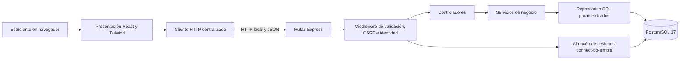

# Arquitectura implementada

Sprint 3, 10 de noviembre de 2026: se incorporan `publication.routes/controller/service/repository` para catálogo, ofertas propias y búsqueda; `AcademicProfile` para HU-03 y `Publications` para HU-04/HU-05/HU-08. `login-attempt.repository` serializa los fallos por cuenta en PostgreSQL y `auth.service` verifica Argon2id dentro de esa operación, sin pasar SQL a React ni a controladores. La API nueva se documenta en `SPRINT_3.md`; políticas y justificaciones en `POLITICA_SEGURIDAD.md`. El mínimo vigente de contraseña es 8; las menciones históricas a 12 o al límite anterior por IP están sustituidas por esa política.

Se conserva la arquitectura cliente-servidor de tres capas y monolito modular del diseño académico. La interfaz nunca ejecuta SQL. Los controladores no conocen tablas; los servicios usan repositorios.

| Capa          | Archivos                                          | Responsabilidad                                                              |
| ------------- | ------------------------------------------------- | ---------------------------------------------------------------------------- |
| Presentación  | `frontend/src/pages`, `components`, `context`     | Pantallas, interacción, estado de carga y errores; identidad visual Stitch   |
| Frontera HTTP | `frontend/src/services/http.js`                   | JSON, cookies, adquisición y rotación de CSRF, errores normalizados          |
| Entrada API   | `backend/src/routes`, `controllers`, `middleware` | Endpoints, traducción HTTP, validación de entrada, identidad y permisos      |
| Negocio       | `backend/src/services`                            | Registro, hash/verificación de contraseña, selección de datos públicos       |
| Persistencia  | `backend/src/repositories`, `db`, `migrations`    | Consultas parametrizadas, transacciones, pool, restricciones y evolución SQL |

El almacén técnico de sesiones accede a PostgreSQL mediante la biblioteca connect-pg-simple. No contiene reglas funcionales ni pasa SQL a React.

## Contrato API

| Método y ruta                     | Acceso             | Resultado principal                                                                        |
| --------------------------------- | ------------------ | ------------------------------------------------------------------------------------------ |
| GET `/api/health`                 | Público            | Comprueba consulta real a PostgreSQL                                                       |
| GET `/api/auth/csrf`              | Público            | Crea token sincronizado con sesión anónima persistida                                      |
| POST `/api/auth/register`         | CSRF               | 201; usuario y perfil creados transaccionalmente; no inicia sesión automáticamente         |
| POST `/api/auth/login`            | CSRF               | 200; regenera ID y token, guarda userId y fecha de autenticación                           |
| GET `/api/auth/me`                | Sesión             | 200; datos públicos de la cuenta consultados nuevamente en PostgreSQL                      |
| POST `/api/auth/logout`           | Sesión y CSRF      | Destruye la fila de sesión y elimina cookie                                                |
| GET `/api/auth/permissions/admin` | Sesión y rol admin | Comprueba permiso; no implementa la gestión de HU-17                                       |
| GET `/api/tutor-profile`          | Sesión             | Perfil de tutor propio o `profile: null` si no se ha creado                                |
| PUT `/api/tutor-profile`          | Sesión y CSRF      | Crea o actualiza el perfil propio con `{headline, bio}`; devuelve 200 y el perfil guardado |

Errores: 401 sin identidad o credenciales incorrectas; 403 por CSRF/origen/permiso; 409 correo duplicado; 422 validación por campo; 400 JSON inválido; 404 ruta desconocida; error controlado de servicio para fallos de infraestructura. La API no devuelve hash, contraseña, traza ni cadena de conexión.

## Sesiones y seguridad

Rutas de datos privados añadidas por solicitud del usuario:

| Método y ruta              | Acceso        | Resultado                                                                                 |
| -------------------------- | ------------- | ----------------------------------------------------------------------------------------- |
| GET `/api/contact-details` | Sesión        | Ciudad/dirección propias o `contact: null`; descifra en el servicio                       |
| PUT `/api/contact-details` | Sesión y CSRF | Valida `{city, address}`, cifra la dirección con AES-256-GCM y guarda una fila por cuenta |

El servicio cifra antes de persistir y descifra solo al responder al propietario. La clave es independiente del secreto de sesión y de las contraseñas. `security/address-crypto.js` usa IV aleatorio, etiqueta de 128 bits y AAD ligado a la cuenta. `security/address-key.js` accede al almacén DPAPI local sin imprimir secretos. Los datos no se añaden al DTO de identidad, al perfil de tutor ni a la sesión. Ver `DIRECCION_CIFRADA.md`.

Argon2id utiliza 19 MiB de memoria, dos iteraciones y paralelismo uno, con salt aleatorio de la biblioteca. Se verifica un hash ficticio también cuando la cuenta no existe para evitar la diferencia evidente de omitir el trabajo criptográfico. Los mensajes de credenciales son iguales.

Cookie `tutorias.sid`: HttpOnly, SameSite=Lax, Path=/ y máximo 8 horas. En producción se activa Secure. HTTP sin Secure se limita al desarrollo local. El servidor comprueba además la edad absoluta de autenticación y el estado/rol actual de la cuenta. No se usan JWT o localStorage.

Todas las mutaciones validan un token aleatorio de 256 bits ligado a la sesión y el origen, si se envía. Tras login se rotan sesión y token; tras logout la cookie antigua ya no permite acceso. Helmet añade cabeceras; express-rate-limit limita registros e intentos fallidos de login. Los límites de desarrollo usan memoria para contadores, nunca para la identidad de sesión.

Referencias técnicas: [OWASP Password Storage](https://cheatsheetseries.owasp.org/cheatsheets/Password_Storage_Cheat_Sheet.html), [OWASP Session Management](https://cheatsheetseries.owasp.org/cheatsheets/Session_Management_Cheat_Sheet.html). Estas decisiones no equivalen a una certificación de seguridad.

## Preparación modular

Los módulos usuarios, tutorías, horarios, comunicación y gestión permanecen distinguibles en navegación y diseño de datos. Usuarios/autenticación y, por ampliación solicitada el 31 de octubre de 2026, el perfil de tutor y los datos privados de ciudad/dirección tienen comportamiento persistente. El sprint 3 incorpora además el catálogo, las publicaciones y los contadores de acceso. Los módulos utilizan rutas → controladores → servicios → repositorios → PostgreSQL y el mismo cliente HTTP y sesión. La API deriva siempre `user_id` de `req.user.id`; no acepta identificadores ni permisos en los formularios. Las rutas no exponen perfiles ni direcciones de otras cuentas. El diseño permite añadir módulos sin cambiar el contrato de identidad. No se solicita geolocalización ni se procesa PDF, mensajes o pagos.

## Espacios de estudiante y tutor

El alta guiada usa `POST /api/tutor-profile/onboarding`; valida datos académicos, materias y dominio declarado antes de guardar la ampliación de la cuenta en una transacción. La identidad devuelve `isTutor`, consultado en PostgreSQL. Los perfiles existentes conservan acceso; guardar un borrador de especialidad/presentación no habilita publicar.

Las nuevas pantallas protegidas separan panel principal, publicaciones propias, creación/edición y perfil de tutor. `GET /api/publications/:id` entrega el detalle visible a la cuenta; `POST /api/publications/:id/view` registra una visita deduplicada con CSRF. El precio se transmite y guarda en centavos enteros por sesión. La dirección sigue fuera de los DTO de catálogo/detalle. La documentación operativa está en `docs/FLUJO_INTERIOR.md`.
