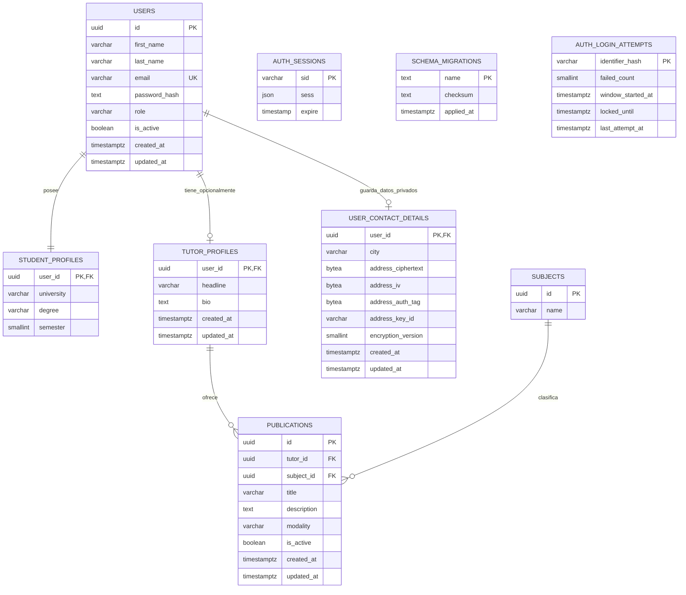
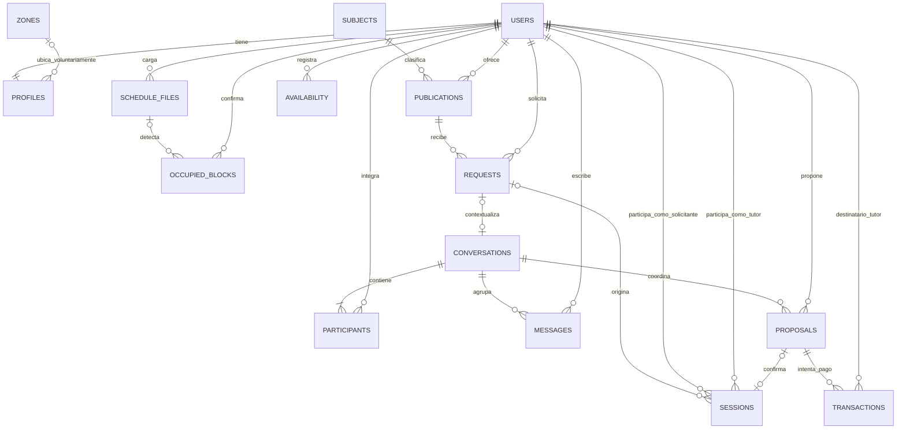

# Persistencia y modelo relacional

Actualización de sprint 3 (10 de noviembre de 2026): la migración `005_sprint_three.sql` agrega `subjects` (catálogo), `publications` (ofertas ligadas al perfil de tutor y asignatura, con estado) y `auth_login_attempts` (HMAC del correo, contador, ventana, bloqueo y último intento). El perfil académico se actualiza en una transacción sobre `users`/`student_profiles`. Los contadores admiten correos inexistentes, por eso no tienen FK a `users`; no guardan correo o contraseña en claro. Los modelos previos permanecen intactos.

Base real: `tutorias_local`, servidor `127.0.0.1:5433`, PostgreSQL 17.6. Rol de conexión `tutorias_app`: LOGIN, NOSUPERUSER, NOCREATEDB y NOCREATEROLE; propietario solo de la base propia. La contraseña aleatoria reside en `backend/.env`, excluida de Git. El propietario técnico inicial de la instancia se protege con DPAPI en `.local/postgres-owner.xml`.

## Modelo físico del incremento actual

`auth_sessions.sess.userId` es una referencia lógica gestionada por express-session, no una FK física. El middleware consulta la cuenta en cada petición protegida y rechaza cuentas inactivas o inexistentes. Las filas anónimas guardan solo los datos de cookie y CSRF. Las filas expiradas se depuran por el almacén. Nunca se guarda una contraseña en la sesión.

El correo se normaliza a minúsculas y sin espacios. El índice único sobre lower(email) protege contra solicitudes concurrentes; no se depende solo de una consulta previa. Usuario y perfil se insertan en una transacción, con rollback ante fallo. El semestre acepta enteros entre 1 y 8. El ajuste solicitado por el usuario se aplica con `002_semester_limit.sql`, conservando la migración inicial. La FK del perfil impide huérfanos y permite limpieza de los datos de prueba propios.

Ampliación solicitada el 31 de octubre de 2026: `003_tutor_profiles.sql` añade el perfil opcional de tutor. `user_id` es simultáneamente PK y FK a `users.id`, por lo que una cuenta tiene cero o un perfil de tutor y no se duplican nombre, correo, contraseña ni datos académicos. La eliminación de una cuenta elimina su perfil mediante `ON DELETE CASCADE`. `headline` admite de 2 a 100 caracteres y `bio`, de 20 a 1500, después de recortar espacios. Se guardan fechas de creación y actualización. Estos textos no tienen cifrado de campos; la contraseña sigue exclusivamente en `users.password_hash` con Argon2id. La existencia del perfil no cambia `users.role`: tutor es una capacidad de la misma cuenta, no un permiso de administrador. Ver `PERFIL_TUTOR.md`.

`backend/scripts/migrate.js` registra un checksum SHA-256 por migración, aplica cada archivo en transacción y usa un bloqueo asesor para impedir ejecuciones simultáneas. Se verificó la segunda ejecución sin duplicar tablas ni datos. Nunca modificar una migración aplicada: crear la siguiente.

La ampliación de ciudad/dirección se aplica con `004_contact_details.sql`. `user_contact_details` comparte la información entre ambos paneles: ciudad en texto legible y dirección cifrada con AES-256-GCM antes de llegar a SQL. La clave se protege fuera de PostgreSQL con DPAPI en `.local/address-key.xml`. Los datos se entregan únicamente al propietario autenticado; no se incluye campus ni coordenadas. Ver `DIRECCION_CIFRADA.md` para formato, límites, conservación de claves y acceso.

## Modelo conceptual completo para evolución

Este diagrama conserva la planificación de HT-03. USERS/PROFILES y, desde sprint 3, SUBJECTS/PUBLICATIONS ya tienen implementación física descrita arriba. Las demás entidades permanecen planificadas. No se atribuyen funcionalidades futuras a los sprints 1 y 2.

| Entidad planificada                     | Claves, relaciones y restricciones previstas                                                                                   | Fuente funcional               |
| --------------------------------------- | ------------------------------------------------------------------------------------------------------------------------------ | ------------------------------ |
| SUBJECTS                                | id, nombre normalizado único por catálogo académico                                                                            | RF-04 y RF-08 ERS              |
| PUBLICATIONS                            | id, tutor_id FK users, subject_id FK subjects, modalidad, estado; unicidad de publicación activa por oferta a definir          | RF-04 ERS; HU-04/HU-05 backlog |
| SCHEDULE_FILES / OCCUPIED_BLOCKS        | estudiante, archivo y bloques detectados; guardar bloques únicamente tras confirmación                                         | RF-05/RF-06 ERS                |
| AVAILABILITY                            | estudiante, día, inicio < fin, zona horaria; intervalos propios sin incoherencias                                              | RF-07 ERS                      |
| ZONES                                   | campus o zona; coordenadas opcionales, consentimiento explícito y revocable                                                    | RF-09 ERS; HU-11 backlog       |
| REQUESTS                                | solicitante y publicación; propuesta de franja, estado; participantes diferentes                                               | RF-10/RF-11 ERS                |
| SESSIONS                                | tutor y solicitante, inicio < fin, estado, origen; bloqueo transaccional/exclusión de doble reserva por definir                | RF-13 ERS                      |
| CONVERSATIONS / PARTICIPANTS / MESSAGES | participantes únicos por conversación, autor participante y acceso limitado; relación con solicitud requerida por ERS original | RF-12 ERS                      |
| PROPOSALS                               | autor tutor, destinatario, conversación, temas, fecha, duración, precio USD ≥ 0; aceptar/rechazar con control de participante  | RF-P02/RF-P03 propuestos       |
| TRANSACTIONS                            | propuesta, tutor receptor, proveedor, identificador externo único, importe en centavos, USD, estado y eventos únicos           | RF-P04/RF-P05 propuestos       |

La conversación previa sin solicitud pertenece a RF-P01 propuesto. No se la declara parte de la ERS original. Una propuesta gratuita no necesita transacción; una remunerada requerirá una confirmación auténtica del proveedor. Son reglas de diseño pendientes de implementación y revisión académica.

## Operación y demostración

`scripts/setup-local-db.ps1` reutiliza los binarios existentes, inicializa solo cuando no hay PG_VERSION y arranca la instancia propia. Nunca borra un directorio de datos. `scripts/show-database.mjs` presenta nombre de base, puerto, cuentas y presencia de hash, sin revelarlo ni mostrar credenciales. El lanzador `Ver base de datos.cmd` permite enseñarlo con doble clic.

Respaldo futuro: pg_dump de `tutorias_local`, con PGPASSWORD únicamente en el entorno del proceso o gestor seguro; restaurar primero en una base distinta. No se probó respaldo/restauración en este incremento y no se afirma lo contrario.

## Ampliación del espacio de tutor y precios por sesión

Las migraciones `006_tutor_workspace.sql` y `007_price_per_session.sql` añaden:

- `tutor_profiles.onboarding_completed_at`: finalización del alta guiada. Los perfiles preexistentes conservan acceso; un borrador creado después no habilita publicaciones.
- `tutor_subjects`: relación entre perfil y asignaturas, PK `(user_id, subject_id)`, FK a perfil/catálogo, nivel autodeclarado 1–5. Se guarda junto a los datos académicos en una transacción.
- `publications.price_cents`: entero entre 0 y 1 000 000; NULL en publicaciones anteriores sin precio conocido. `price_unit` utiliza `session` en el contrato actual y por defecto de PostgreSQL. La API expresa moneda USD.
- `publication_views`: PK `(publication_id, viewer_id, viewed_on)`, FK con eliminación en cascada. Deduplica por estudiante/día y excluye al propietario en la persistencia. Los endpoints de propietario devuelven solo conteos agregados, no visitantes.

La dirección opcional de registro se cifra antes de persistir y se inserta en la misma transacción que usuario/perfil. No se crearon tablas de pagos, reservas, ingresos o mensajería. Guía actual: `docs/FLUJO_INTERIOR.md`.
